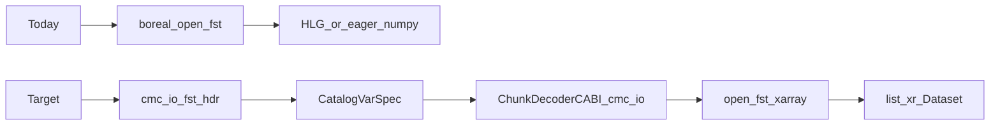

# Context: Accelerate FST → xarray Dataset Load

Working brief for the next engineering goal: make **decoded, uncompressed FST fields** available as genuine `xarray.Dataset` objects through `marray-mask`, without Dask HighLevelGraph construction or eager full-cube peels.

Do not embed absolute suite or checkout paths in code or docs. Use `MARRAY_CMC_IO` and `MARRAY_FST_PRES_ROOT` (or CLI `--root`) on the work machine.

---

## 1. Goal

Replace boreal-io’s `open_fst` path (Dask HLG for `chunks="record"|"column"`, or eager NumPy for `chunks=False`) with marray-mask’s **`RecordCatalog` + `MarrayDuckArray`** so callers receive:

```text
list[xr.Dataset]   # one Dataset per compatible group (vctype / grid / ragged rules)
```

Each data variable is backed by a duck array that **lazily whole-plane-decodes** FST records (`datyp=134`, bitmaps, …) only when `.isel` / `.sel` / `.compute` / ufuncs demand it. CF coords, OpenData names, and `fst_*` attrs must stay compatible with polaris, mogc-api, boreal-postproc, and boreal-stat.

**Success looks like:** `dss = open_fst_xarray(paths)` (or `xr.open_dataset(..., engine="marray_fst")`) returns usable Datasets in ≪1 s for multi-lead catalogs, with RAM dominated by headers + working planes—not a full unpacked cube or a giant HLG.

---

## 2. Why it matters

FST **unpack codecs are already Mojo** inside boreal-io (`cmc_io_fst_data`). The remaining tax on the boreal stack is:

- Python Dataset assembly and **dask HighLevelGraph** construction inside `open_fst`
- **Peel → contiguous buffer → rewrap** around every consumer kernel

See [`docs/boreal/README.md`](docs/boreal/README.md). Serving apps (mogc GetMap) often spend **~0.3–1 s on cold `open_fst`** before cache (Q12 in [`docs/questions.md`](docs/questions.md)).

Post-decode **compute** is already strong: real GDPS `pres` smoke (`bench_fst_real`) showed ~**55×** thin 2D peel and ~**19×** KE / weighted reductions vs column-HLG / eager xarray on the same arenas ([`docs/questions.md`](docs/questions.md) §5). The stack-level win for “load into xarray” is finishing the **open/decode wiring**, not reinventing the morsel VM.

---

## 3. Current vs target



| | Today (smoke / hybrid) | Target (P0) |
|--|------------------------|-------------|
| Open | `boreal.io.open_fst(..., chunks=False)` eager unpack | Header scan only → `CatalogVarSpec` |
| Decode | Real `cmc_io` in Phase 0; M1 R-B6 **re-packs** with **builtin** reference codec | Live `ChunkDecoderCABI` → `cmc_io_fst` `unpack_*_from_raw` |
| xarray | NumPy after eager open, or duck over re-packed archive | `MarrayDuckArray` over ops mmap / `pread` |
| Graph | Dask HLG when using boreal lazy chunks | **No Dask** for compute |

---

## 4. What already exists

| Piece | Location | Notes |
|-------|----------|--------|
| M1 catalog engine | [`src/marray/catalog.mojo`](src/marray/catalog.mojo), [`python/marray_xr/catalog.py`](python/marray_xr/catalog.py) | `ChunkDecoderCABI`, `PlaneSlotCache`, `open_fst_catalog`, builtin `datyp=134` / `@@` reference codecs |
| M4 Phase A duck | [`python/marray_xr/duck.py`](python/marray_xr/duck.py) | `MarrayDuckArray`, `open_fst_xarray(archive)` — **archive is `PackedFSTArchive` today, not ops paths** |
| CF / open contract | [`docs/boreal/03-open-fst-and-cf-assembly.md`](docs/boreal/03-open-fst-and-cf-assembly.md), [`06-cf-attrs-and-consumer-contract.md`](docs/boreal/06-cf-attrs-and-consumer-contract.md) | `list[Dataset]`, `vctype` split, `fst_nomvar`, `areacell`, `rlat`/`rlon` |
| Real-FST bench | [`benchmarks/bench_fst_real.py`](benchmarks/bench_fst_real.py), [`benchmarks/fst_real_load.py`](benchmarks/fst_real_load.py) | Env-gated; decode vs compute phases |
| Design answers + wishlist | [`docs/questions.md`](docs/questions.md) | Q1–Q15 answered; **§5 P0 items 16–20** are this goal |
| Roadmap | [`docs/ARCHITECTURE_AND_ROADMAP.md`](docs/ARCHITECTURE_AND_ROADMAP.md) §8 M1/M4 “next steps” | Wire `cmc_io` + BackendEntrypoint |
| Checklist | [`docs/boreal/10-mojo-replacement-checklist.md`](docs/boreal/10-mojo-replacement-checklist.md) | Acceptance sketches for open / W1 / postproc |

**ABI contract (Q1):** production = separate `.so` files. marray calls a thin C-ABI function pointer into boreal’s unpacker; do not import `cmc_io_fst_data` from inside the morsel VM.

**Decode contract (Q4):** `datyp=134` is **whole-record**; regional slices decode the full `(ni,nj)` plane once (`PlaneSlotCache`), then copy the window.

---

## 5. Gap — do this next (P0)

1. **Live headers → catalog** — Map `cmc_io_fst_hdr` rows (`path`, `addr`/`lng`, `datyp`, `nbits`, `ni`/`nj`/`nk`, companion mask offsets) into `CatalogVarSpec` / archive meta **without re-encoding** payloads.
2. **Real ChunkDecoder** — Export or adapt a `ChunkDecoderCABI`-compatible symbol from `cmc_io_fst` (`unpack_*_from_raw`) so `decoder_fn_addr` is production codecs, not `marray_builtin_fst_chunk_decoder` on re-packed bytes.
3. **I/O pool** — OS `mmap` / `pread` + per-worker fd cache for multi-file leads (keep Python memmap LRU off the hot path).
4. **`open_fst_xarray(paths)`** — CF parity with boreal assembly: dims (`time`, `vertical`, `rlat`/`rlon` or `y`/`x`), `fst_*` attrs, `areacell`, `vctype` / grid split → `list[xr.Dataset]`, zero Dask HLG.
5. **BackendEntrypoint** — `xr.open_dataset(..., engine="marray_fst")` (ARCHITECTURE M4 next step).

P1+ (postproc drop-in, M3 `where`, aether handoff, streaming write, packed `@@`) is listed in [`docs/questions.md`](docs/questions.md) §5 but is **out of scope** until the load path works.

---

## 6. Acceptance (load path)

- Multi-lead GDPS-style archive: **catalog open is O(headers)** and uses ≪ RAM of a record-chunk Dask HLG.
- First thin `.isel(time=…)` + nearest `vertical` materializes **only needed planes** (plus bitmap if present).
- Returned objects are real `xr.Dataset`s (coords, attrs, OpenData names) usable by unmodified xarray consumers; **no Dask import required for compute**.
- Parity: bit-close to boreal `open_fst(..., chunks=False)` on sampled peels (tolerate `datyp=134` quantization).
- KPI: extend `bench_fst_real` to report **lazy open + first `.isel` compute** vs boreal `chunks="column"|"record"|False` on the same leads (wishlist item 28).

---

## 7. How to work / verify

```bash
export MARRAY_CMC_IO=...          # boreal-io / cmc-io checkout (cmc_io_fst_*.so)
export MARRAY_FST_PRES_ROOT=...   # GDPS-style prog/pres directory of leads
pixi install
pixi run build-ext
pixi run bench-fst-real -- --smoke
# fuller / PBS: see scripts/pbs/bench_fst_real.sh (requires the same env vars)
```

**Read next (in order):**

1. [`docs/questions.md`](docs/questions.md) §5 P0 (items 16–20)
2. [`docs/ARCHITECTURE_AND_ROADMAP.md`](docs/ARCHITECTURE_AND_ROADMAP.md) §8 M1 & M4 next steps
3. [`docs/boreal/03-open-fst-and-cf-assembly.md`](docs/boreal/03-open-fst-and-cf-assembly.md)
4. [`docs/boreal/02-fst-decode-pipeline.md`](docs/boreal/02-fst-decode-pipeline.md)
5. [`docs/boreal/10-mojo-replacement-checklist.md`](docs/boreal/10-mojo-replacement-checklist.md)
6. Code: `catalog.mojo` / `catalog.py` / `duck.py` / `ChunkDecoderCABI` signature in `catalog.mojo`

---

## 8. Out of scope for this brief

- Replacing **aether** CSR remapping inside the morsel VM
- Full M3 (boolean `where`), M5 (stencils), M6 (multi-node / GPU)
- Committing operational suite paths or FST binaries
- Changing published synthetic B1–B8 numbers

---

## 9. P0 Implementation Status (Ready for Work-Machine Real-FST Smoke)

Wired and verified for **CF assembly + thin peel + R-P0 KPI** (`pixi run test` + `pixi run test-p0` + `bench-fst-real`). **Live ops FST cold open is still slower than boreal** — see [`docs/boreal/13-cold-open-work-machine.md`](docs/boreal/13-cold-open-work-machine.md).

1. **Multi-file OS I/O pool (`src/marray/catalog.mojo`, `python/marray_xr/catalog.py`):**
   - `CatalogFilePool` (`marray_file_pool_create` / `marray_file_pool_destroy`) manages read-only POSIX file descriptors across multi-lead files using thread-safe `pread` (`_pread_exact`), keeping Python `np.memmap` LRU off the hot path.
   - `REC_META_STRIDE = 10` (`[file_id, d_off, d_len, datyp, nbits, bmap_file_id, bm_off, bm_len, b_dt, b_nb]`) supports multi-file records, `@@` companion bitmaps, ragged `pad` missing slots (`d_len <= 0`), and RPN alt-masks (`64 <= datyp < 128`, max-value marks missing).
   - Shared single-plane pre-decode (`load_morsel_from_predecoded_catalog` in `catalog.mojo` / `vm.mojo`) ensures thin 2D peels (`n_cats * n_zt <= 48`) decode each touched `(var, rec_idx)` plane **once** across all 16 worker threads (`mxr.get_last_decoded_planes() == 2` on `hypot(u2d, v2d)`).
   - Pool is used for `.mfst` and Tier A; **Tier B (current ops default) skips the pool** (`CAT_FLAG_ADDR_MODE | CAT_FLAG_FORCE_SERIAL`).
2. **Live `open_fst_xarray(paths)` (`python/marray_xr/fst_open.py`):**
   - Accepts operational `.std` / `.fst` lead paths (via `MARRAY_CMC_IO` / `cmc_root`) or standalone `.mfst` multi-lead files.
   - **`.mfst`:** true O(headers) catalog + `FilePool` (what `test-p0` measures).
   - **Ops `.std` (RC1–RC5 fix wave implemented, pending HPC re-verify — [`docs/boreal/13-cold-open-work-machine.md`](docs/boreal/13-cold-open-work-machine.md) §10):**
     * Removed recursive `cmc_dir.glob("**/cmc_io_fst_data*.so")` (`~960 ms` constant open penalty on HPC) in favor of `@lru_cache` O(1) path checks accepting both `MARRAY_CMC_DECODER_SO` and `MARRAY_CMC_CABI_SO`.
     * Parallelizes `read_records_fast` across lead files (`ThreadPoolExecutor`) + pre-filters raw header rows to requested `nomvar`s + RPN meta/mask companions before Python DataFrame enrichment, and intercepts `_stack_variable` to build `CatalogVarSpec` + `MarrayDuckArray` directly from record columns with **zero Dask HLG construction** and **zero double `xr.Dataset` rebuild** (verified locally in `pixi run test-p0`; full standalone `cmc_io_fst_hdr` without `boreal.io.xarray.open` remains a future boreal-io/marray step).
   - **Decoder resolution:** [`bridges/cmc_io_cabi_shim.mojo`](bridges/cmc_io_cabi_shim.mojo) rewritten against `cmc_io_fst.xdf.unpack_batch` (`MutPtr`, `unpack_one_f32`) and auto-compiled into `build/libcmc_marray_bridge.so` by `pixi run build-ext` ([`bridges/build_cmc_bridge.py`](bridges/build_cmc_bridge.py)) when `MARRAY_CMC_IO` is set (**Tier A** 16-thread `FilePool` `pread` on `XDF0`); falls back to **Tier B** (`ctypes` trampoline → keyword-only `unpack_record_from_path(..., layout="C")`) for `RSF0` or when unbuilt.
3. **Xarray `BackendEntrypoint` & `ChunkManagerEntrypoint` (`python/marray_xr/xarray_backend.py`, `pyproject.toml`):**
   - Registers `engine="marray_fst"` (`MarrayFstBackendEntrypoint`) and `chunked_array_type="marray"` (`MarrayChunkManager`) both in `pyproject.toml` and dynamically on `import marray_xr` (works under `PYTHONPATH` on PBS nodes without `pip install`).
   - Hooks `da.compute()`, `ds.compute()` (single-pass multi-sink `compute_many`!), and zero-decode `repr(ds)` with **zero Dask dependency**.
4. **Work-machine R-P0 KPI verification (`benchmarks/bench_fst_real.py`):**
   ```bash
   export MARRAY_CMC_IO=...
   export MARRAY_FST_PRES_ROOT=...
   pixi run test-p0
   pixi run bench-fst-real -- --smoke --mode lazy-open
   pixi run bench-fst-real -- --leads 4 --mode both
   ```
   Handoff / backlog: [`docs/boreal/13-cold-open-work-machine.md`](docs/boreal/13-cold-open-work-machine.md).
