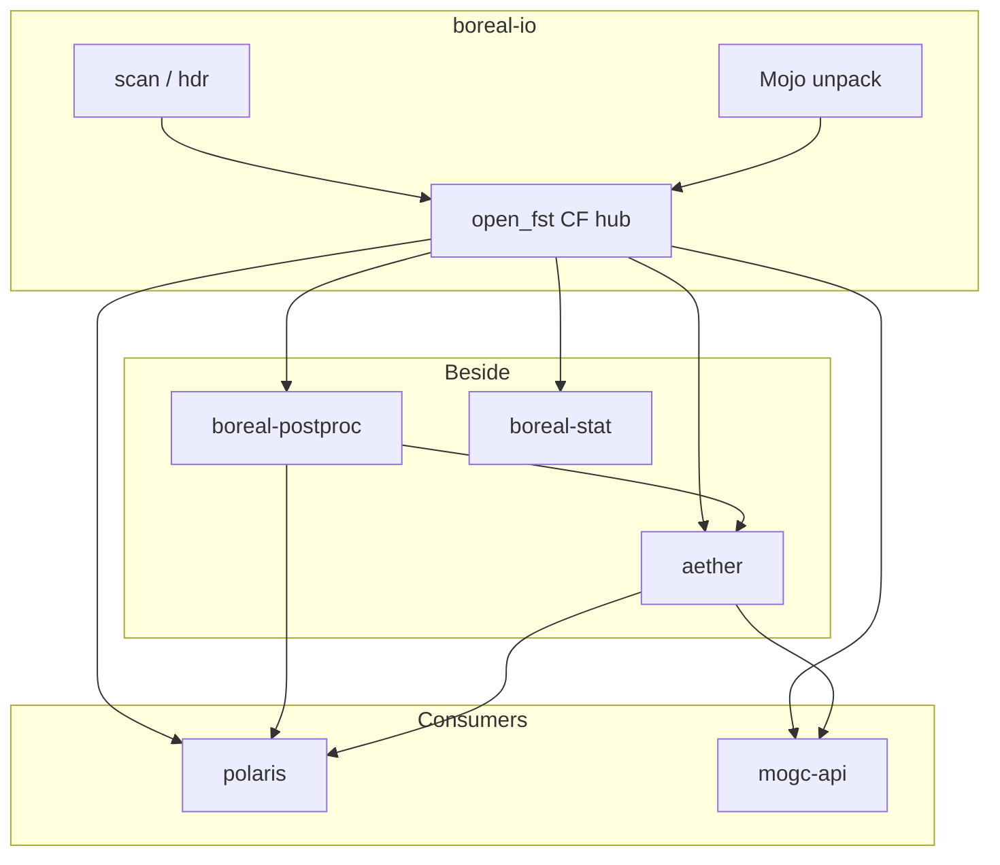

# Stack map: roles and Mojo vs Python

## Package roles

| Package | Owns | Does not own |
|---------|------|----------------|
| **boreal-io** | FST/BURP crack, unpack, write; DataFrame scan; `open_fst` / CF assembly; masks/pressure helpers for I/O; `ci_fstcomp` | Field diagnostics (→ boreal-stat); Spooki meteo plugins; remapping |
| **boreal-stat** | r.diag-style metrics on `open_fst` cubes (KE, zonavg, pair RMSE, …) | FST I/O; Spooki plugins |
| **boreal-postproc** | Spooki-compatible plugins (`Humidex`, `WindModulus`, vertical/parcel ops, …) on CF Datasets | FST open/write (calls boreal-io); weight build (often aether) |
| **aether** | Horizontal CSR remapping; vertical Visint/ZRef-style interp; Parquet weight reuse | FST read/write (`docs/INSPIRATION.md`: “FST read and write are boreal-io”) |
| **polaris** | Globe/API: open lead → optional postproc → aether → colorize | I/O codecs; kernel libraries |
| **mogc-api** | OGC-ish GetMap/Coverage over FST via boreal-io + aether + paint | GDAL / MapServer |

Shared cube contract: **`list[xarray.Dataset]`** from `boreal.io.open_fst`, with CF dims/coords and `fst_*` attrs (see [06-cf-attrs-and-consumer-contract.md](06-cf-attrs-and-consumer-contract.md)).

## Already Mojo vs still Python

| Layer | Runtime today | Notes for marray-mask |
|-------|---------------|------------------------|
| XDF/RSF directory scan | Mojo `cmc_io_fst_hdr` (+ Python fallbacks) | Feed `RecordCatalog` |
| Datyp unpack | Mojo `cmc_io_fst_data` (`unpack_many_*_into`) | `ChunkDecoder` trait |
| CF Dataset assembly | **Python** (pandas + xarray) | Labeled frontend / duck array |
| Lazy open graphs | **Python** dask `HighLevelGraph` in `stack.py` | Parametric catalog + morsel schedule |
| Bitmap apply on unpack | Python/`numpy.where` around Mojo slabs | Fold into decode → `MSTATE_*` |
| Thermo / wind / r.diag kernels | Often Mojo `.so` with NumPy fallback | Keep; avoid peel/rewrap tax |
| Horizontal CSR apply | Mojo (aether) default | Buffer handoff, not reimplementation |
| Vertical FindPos / Interp1D | Mojo (aether) | Same |
| Multi-field Python loops | **Python** | Batch / fused plans |
| Viz / HTML / galleries | Python | Non-goal to Mojo-ify |

## Data contract between packages

1. **Open:** `datasets = open_fst(paths, engine="mojo", chunks=...)` → zero or more Datasets (never assume a single cube).
2. **Identity:** resolve fields by `attrs["fst_nomvar"]` (or OpenData name when `open_data_mapping=True`); raw code always recoverable.
3. **Layout:** trailing horizontal dims `(…, y, x)` or CF lat/lon / rlat/rlon; physical payloads typically `float32` (sometimes `float64` for IEEE `datyp=5` with wide `nbits`).
4. **Missing:** in-memory NaN after bitmap apply; `fst_mask_fill=1e30` for write identity ([05-masking-missing-data.md](05-masking-missing-data.md)).
5. **Stamp:** postproc uses boreal-io metadata helpers (`update_metadata`, `old_*`) before `write_fst`.

## Adjacent projects (brief)

- **mozarr** — Mojo Zarr V3 encode sink; loads still often materialize dask/numpy windows then encode. Relevant to streaming `sink_to_*` (roadmap M1), not to FST decode.
- **fst-classifier-mojo** — suite-scale **header** catalogs → Parquet. Natural feedstock for a mmap `RecordCatalog` without reading payloads.
- **fst-xarray-dataset** — earlier Mojo crack/unpack → numpy/dask lineage; production path is boreal-io.

Kerchunk is **not** used; the Zarr bridge is VirtualiZarr + `FstRecordCodec` ([04-lazy-layouts.md](04-lazy-layouts.md)).
