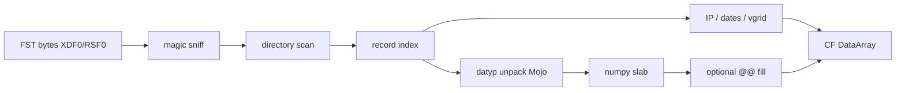

# FST decode pipeline (boreal-io)

Product runtime is **Mojo + Python**. `librmn` / `fstpy` / `fstd2nc` are **format oracles** and optional engines—not required for the default `engine="mojo"` path.

Primary modules (boreal-io tree): `src/boreal/io/fst/`, `src/boreal/io/xarray/decode.py`, Mojo `cmc_io_fst_hdr` / `cmc_io_fst_data`.

## End-to-end read path

## Containers

| Magic | Format |
|-------|--------|
| `XDF0` + appl `STDR`/`STDS` | Classic XDF standard file |
| `RSF0` + appl `STDF` | FST-on-RSF (fst24) |

- **XDF:** file header + directory pages (256 entries/page); `stdf_dir_keys` as 18×32-bit FST98 fields; payloads located by directory offsets.
- **RSF:** SOS / SOR / EOR / VDIR / EOS; Mojo normalizes SOR segments toward an XDF-like body (including the historical 80-byte meta prefix convention) before shared unpackers run.

Acceptance compares keys (and payloads) across XDF and librmn-converted RSF twins. Authoritative bit layouts live in librmn headers used as **spec only**.

## Record index → RecordCatalog fields

`scan` / Mojo `list_headers` produce rows that marray-mask should treat as catalog entries:

| Field | Role |
|-------|------|
| `path` | File identity for `pread` / mmap |
| `addr` / `swa` | Origin-1 **word** address; byte offset ≈ `(addr - 1) * 8` |
| `lng` | Length in 32-bit words (payload span includes container meta conventions) |
| `ni`, `nj`, `nk` | Horizontal/vertical packing dims |
| `datyp`, `nbits` | Codec selection |
| `nomvar`, `typvar`, `etiket` | Variable / mask / label identity |
| `ip1`, `ip2`, `ip3`, `ig1`–`ig4`, `grtyp` | Level, grid, interval keys |
| date fields | Validity / run stamps (decoded at higher metadata levels) |
| mask links | Optional `mask_addr` / `mask_lng` after pairing ([05](05-masking-missing-data.md)) |

`DecodeLevel` in boreal-io (`none` | `keys` | `selective` | `full`) controls how much IP/date/vgrid enrichment runs before open. Lazy `open_fst` keeps **headers only** (`addr`/`lng`) until a dask task or eager stack unpacks.

## Datyp codec matrix

Supported Mojo product datyps (`_MOJO_SUPPORTED_DATYP` in `decode.py`):

| datyp | Behavior |
|-------|----------|
| `0` | Raw int32 slab → float32 |
| `1` | Mojo `compact_float` (ULP differences vs librmn possible on sparse cells) |
| `2` / `4` | Unsigned / signed `compact_integer` |
| `5` | IEEE big-endian float32/float64 (`nbits` wide → f64) |
| `6` | `float_packer` path (Python/librmn-style; batch may mirror) |
| `130` | fstzip + uint16 |
| `133` | `armn_uncompress32` |
| `134` | `armn_uncompress` + float unpack |

Hot path: **`unpack_many_f32_into` / `unpack_many_f64_into`** into a caller-owned arena (descriptor rows: addr, lng, ni, nj, nk, datyp, nbits, …). Single-record helpers: `unpack_*_into`.

I/O mechanics:

- Process-local **`np.memmap`** LRU (small fixed cap) over whole files.
- Unpack destinations must be writable C-contiguous for Mojo `from_numpy_array` borrows.
- Default payload dtype **float32**; float64 when IEEE `datyp=5` and large `nbits`.

## Layout: Fortran plane in a C cube

Unpackers often emit **Fortran-linear** `(ni, nj)` bytes. CF cubes in `open_fst` use trailing **`(…, nj, ni)`** C-contiguous views: the same plane bytes, interpreted as row-major `(y, x)` / `(nj, ni)`.

marray-mask should preserve stride-1 innermost horizontal fidelity and avoid mandatory `ascontiguousarray` transposes on every op.

## Engines

| `engine=` | Behavior |
|-----------|----------|
| `"mojo"` (default) | Mojo headers + Mojo unpack; lazy open = addresses only |
| `"librmn"` | Serial `fstluk`-style oracle loads |
| `"fstpy"` | StandardFileReader / DataFrame oracle |

Optional consumer shims (`CMC_IO_FSTPY_BACKEND`, `ci_fstcomp` backends) swap index+payload under fstpy/compare without changing their business logic.

## Abstractions a Mojo orchestrator must match

1. Container sniff + directory listing for XDF and RSF.
2. Cracked key table → catalog rows above.
3. Datyp codec matrix writing into caller buffers (batch preferred).
4. IP / CMC date / hybrid `!!` A/B[/C] semantics at the metadata layer (see open_fst assembly).
5. Mask pairing and polarity ([05](05-masking-missing-data.md)).
6. Optional virtual byte-range contract: payload range **without** in-chunk mask apply ([04](04-lazy-layouts.md)).
