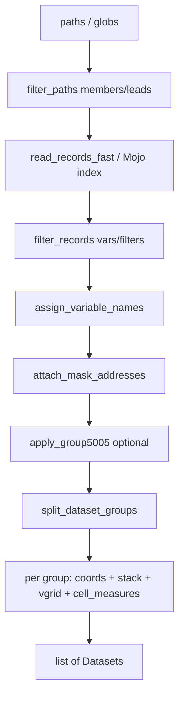

# `open_fst` → CF Dataset assembly

Public API: `boreal.io.open_fst` / `open_fst_one` in `src/boreal/io/xarray/open.py`.

Returns **`list[xarray.Dataset]`**—one Dataset per compatible record group—not a single merged cube. Callers often write `ds, = open_fst(...)` when they expect exactly one family, or iterate the list (polaris/mogc/stat helpers normalize lists).

## Pipeline stages

1. **Path expansion / filters** — same rules as `scan.expand_paths`; optional filename filters for ensemble members and forecast leads.
2. **Record table** — Mojo lazy: headers with `addr`/`lng` only. Eager engines may fill payload column `d`.
3. **Metadata decode** — IP intervals, levels, ensemble member, CMC dates when filters/`group5005`/members require it.
4. **Row filters** — `vars`/`nomvars`, expression `filters`, members; meta axis records (`>>`, `^^`, `^>`, …) are kept.
5. **Naming** — optional OpenData mapping (`TT` → `AirTemp`, …); original code in `attrs["fst_nomvar"]`.
6. **Mask attach** — link `*@` typvars to `@@` / `!@` bitmap addresses ([05](05-masking-missing-data.md)).
7. **group5005** — fold meter diagnostic levels into hybrid cubes (Spooki ReaderStd parity); disable to keep separate HYBRID cubes.
8. **Grouping** — `split_dataset_groups` keys include grid identity, `vctype`, `ni`/`nj`, `grtyp`, and (with ragged rules) ip1/time sets.
9. **Per-group Dataset** — time / vertical / member / horizontal coords, CRS, `_stack_variable` for each data var, vgrid attach (`hyb_a`/`hyb_b`/…), optional `areacell` and yin-yang masks.

Empty field selection after explicit filters raises `EmptySelectionError` (meta-only results are rejected when a selection was requested).

## Typical dims and coords

**Field data vars** usually carry:

- `time`
- `vertical` (pressure / hybrid / sigma-style coordinate from IP decode)
- optional `member` (ensemble)
- horizontal: `rlat`/`rlon` (+ 2-D `lat`/`lon`), or 1-D `lat`/`lon`, or `y`/`x`

**Meta / companions:** tic-tac `>>`/`^^`/`^>` as CF coords; `!!` / `HY` / `P0` via vgrid attach; JSON-safe packing of leftover meta in Dataset attrs (`fst_meta_records`, `fst_toctoc`, …).

## Ragged cubes: `split` vs `pad`

| `ragged=` | Behavior |
|-----------|----------|
| `"split"` (default) | Variables share a cube only when `(ip1 set, validity set)` match; differing level sets across times become separate time-block Datasets—**no NaN padding** (Spooki record-group style). |
| `"pad"` | Legacy union over times with NaN in missing level/time slots. |

## Yin–Yang `subgrid`

For `grtyp=U`:

- `"all"` — stacked supergrid (default)
- `"yin"` / `"yang"` — single panel with that panel’s CF CRS

`chunks="virtual"` rejects yin/yang panel slicing (must be `"all"`).

## Stacking entry points

`_stack_variable` in `src/boreal/io/xarray/stack.py` chooses:

- lazy dask column/record cubes when Mojo addresses are present and `chunks` requests laziness
- eager `unpack_many` from `path`/`addr`/`lng` when `chunks=False`
- placement of already-materialized `d` slabs for oracle engines
- VirtualiZarr `ManifestArray` when `chunks="virtual"`

Details: [04-lazy-layouts.md](04-lazy-layouts.md).

## Cell measures and CRS

- `cell_measures=True` (default): attach `areacell` / CF bounds and stamp `cell_measures` on data vars (needed for boreal-stat weighted global means).
- `yin_yang_mask=True`: opt-in stitch-free global integral helpers for `U` grids.
- CRS vars via grid handlers; aether may recover lon/lat from RPN attrs when CF coords are thin ([07](07-aether-xarray-usage.md)).
