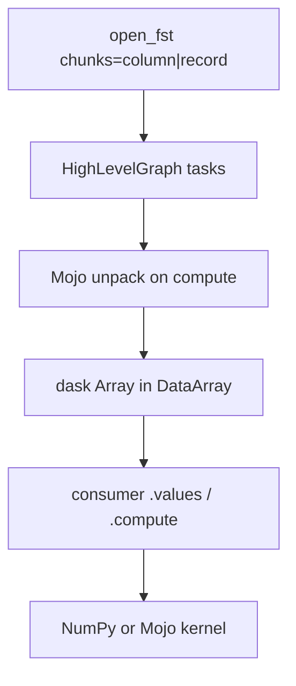

# Lazy layouts: column, record, eager, virtual

There are **two different “dask problems”** in the boreal stack:

1. **Inside `open_fst`** — custom dask `HighLevelGraph` graphs for `column` / `record` chunks. This is the suite-scale graph construction / Amdahl target for marray-mask (roadmap §1.1).
2. **In consumers** — classic Dask APIs (`map_blocks`, `rechunk`, `Client`, `delayed`, `persist`) are **essentially unused**. Apps pick `chunks="record"` or `chunks=False`, then **peel to NumPy/Mojo** ([08](08-peel-kernel-rewrap.md)).

Optional dependency: `boreal-io[xarray-lazy]` → `dask[array]`.

## Mode summary

| `chunks=` | Backing | Chunk / array shape | Decode | Typical users |
|-----------|---------|---------------------|--------|---------------|
| `True` / `"column"` / `"auto"` / `"time"` | dask Array | `(1, n_z[, 1], nj, ni)` per time×member | Mojo `unpack_many` | Default open; vertical columns |
| `"record"` / `"records"` | dask Array | `(1, 1[, 1], nj, ni)` | Single record unpack | polaris thin 2-D peels |
| `False` / `"eager"` / `"none"` | numpy | Full cube | `unpack_many` / arena | postproc CLI, mogc hot path |
| `"virtual"` | VirtualiZarr `ManifestArray` (**not** dask) | One FST record per chunk | Byte-range + `FstRecordCodec` later | Zarr / Icechunk bridge |

## HighLevelGraph construction (`stack.py`)

Lazy cubes are **not** built with `dask.array.map_blocks` on the hot path. Instead:

- `tokenize(...)` over `(path, addr, lng)` (and shape/dtype/mode).
- Tasks call `_lazy_column_chunk` or `_lazy_record_chunk`.
- Those call `unpack_records_into_path` / `unpack_record_from_path`, then apply bitmap fill in-process.
- Missing slots become NaN blocks.
- If an engine already filled payload `d` but `use_dask=True`, the cube is eager numpy then wrapped with `da.from_array(...)`.

Column mode groups all vertical levels for one time (× member) into **one** task so Mojo can `unpack_many` once per file batch. Record mode is cheapest for single-level compute but creates **more graph nodes** (one per FST record).

## Why this matters for marray-mask

- Graph construction cost scales with **ops × chunks**. Large archives with record-sized chunks recreate the roadmap §1.1 failure mode even when each unpack is microseconds of Mojo.
- A parametric `RecordCatalog` + morsel pull schedule should present the **same logical chunk shapes** (column vs record) without materializing a Python task dict per record.
- Consumers rarely need a distributed scheduler; they need **open without OOM**, then blockwise kernels with mask/attr fidelity.

## VirtualiZarr mode

`chunks="virtual"`:

- Same record layout intent as `"record"`, but each chunk is a **byte-range reference** (`ChunkManifest`: path URI, offset, length from `ranges.record_payload_range`).
- Codec entry points (`boreal.fst_record` / `cmcio.fst_record`) → `FstRecordCodec`: prepend 80 zero bytes, decode payload, reshape to C `(…, nj, ni)`.
- Requires uniform packing per variable; **`apply_masks=True` is rejected** (a masked value needs two ranges).
- Kerchunk is **not** used.
- Readers of virtual stores still need boreal-io installed for the codec.

## Spatial rechunk helpers

`boreal.io.xarray.chunks` offers post-open `rechunk_for_spatial` / size hints for stencil-style workflows. This is optional sugar—not the open hot path—and still assumes dask Arrays.

## Practical guidance for Mojo replacement

| Goal | Prefer |
|------|--------|
| Replace open-time graph explosion | Catalog + schedule equivalent to `column`/`record` |
| Match polaris latency path | Record-sized decode + 2-D peel without HLG |
| Match postproc/mogc | Eager or morsel-streamed cubes; no dask Client |
| Zarr publish | Preserve virtual byte-range + codec contract or stream encode without full `.compute()` windows |
