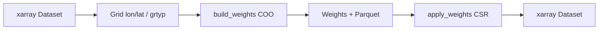

# aether: xarray in / xarray out

**aether** is a Mojo-accelerated remapper for CMC and CF grids (horizontal + vertical). It does **not** own FST I/O—read/write stay in boreal-io.

## Horizontal data flow

1. Resolve source/destination `Grid` from Dataset coords or RPN attrs (`grtyp`, `ig*`, tic-tac axes).
2. Build stencil / conservative / proxy weights (Mojo when `n_dst` large under `auto`; else NumPy).
3. Cache COO→CSR; optional Parquet round-trip for reuse.
4. Apply via Mojo CSR SpMV by default (`AETHER_APPLY_BACKEND`); SciPy CSR fallback.
5. Return remapped Dataset with provenance attrs; multi-field loops remain Python-orchestrated (`Regridder` session, optional `var_workers`).

## Vertical data flow

- Destination-first or src/dst `VerticalRemapper` / `to_pressure` over Visint + ZRef-style engines.
- Build lnP or height cubes from vcodes / descriptors (boreal-io HY/ETA quirks: units, `fst_vcode`).
- **FindPos once**, then column / planar Interp1D (+ optional extrap).
- Still cube-shaped NumPy/xarray around Mojo kernels.

## FST coupling (dev / gallery only)

- `open_fst` for live galleries and ops catalogs; product API is Dataset-in.
- May patch positional `>>`/`^^` when open_fst left them as data_vars without CF attachment.
- Weight cache keys use grid fingerprint (`grtyp`/`ig1..ig4` + sizes).

## Dask role

dask is a **dev** dependency for some gallery paths—not the core apply engine. Live FST demos often use `open_fst(..., chunks=False)` so walls are I/O + plot, not scheduler. Acceleration wins are reported on **multi-field cubes** (many 2-D fields through one CSR), not on single-field SciPy parity.

## Handoff target for marray-mask

| Today | Desired |
|-------|---------|
| Materialize each field to contiguous ndarray before CSR | Duck array / MAX Buffer / DLPack spanning plan → apply |
| Python loop over variables | Batch apply under one compiled plan or shared weight matrix |
| Full-slab intermediates between H then V chains | Stream morsels or keep device/host buffers hot |
| Weights owned as Parquet + CSR | **Keep in aether**; marray should not reimplement weight builders (see [11](11-non-goals.md)) |

Roadmap M5 (stencils / regrid) can eventually absorb *some* horizontal finite differences inside the VM; production georef remapping remains aether’s CSR/Parquet stack until an explicit merge of IR ops.
