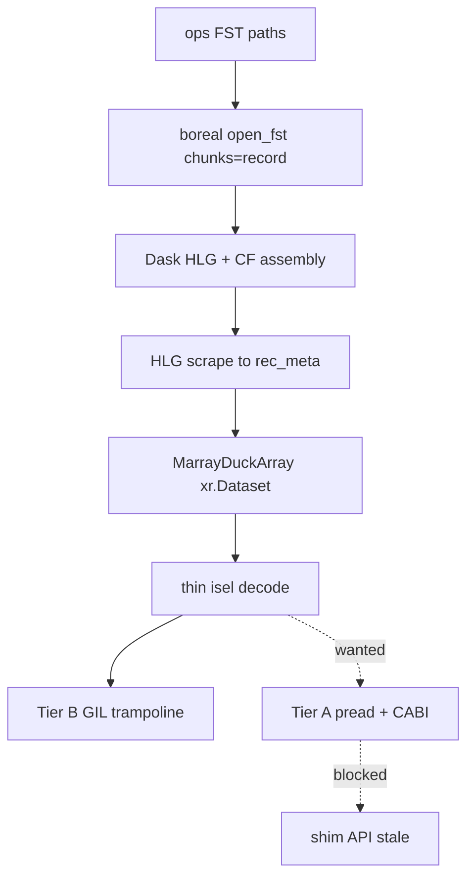

# Cold open of live FSTs — work-machine handoff

Handoff note for accelerating **cold open** (lazy and eager) of operational FST
files for **boreal-io** consumers. Complements
[`10-mojo-replacement-checklist.md`](10-mojo-replacement-checklist.md) acceptance
and [`questions.md`](../questions.md) §5 P0 items 16–20.

**Do not embed absolute suite or checkout paths.** Use `MARRAY_CMC_IO` and
`MARRAY_FST_PRES_ROOT` (or CLI `--root`) on the work machine.

---

## 1. Verdict

**Live ops FST cold open is not faster than boreal today.**

`marray_xr.open_fst_xarray` on real GDPS `pres` still calls full
`boreal.io.open_fst(..., chunks="record")`, scrapes the Dask HLG for record
specs, then rebuilds a catalog + `xr.Dataset`. That pays boreal open **plus**
~1 s of Python rebuild tax.

What *is* faster today:

| Stage | Status |
|-------|--------|
| Synthetic `.mfst` / `pixi run test-p0` | True O(headers) open (~14 ms) — **no** boreal `open_fst` |
| R-B2 / R-B4 on real arenas (after load) | Peel / KE ≫ column HLG / eager |
| First thin peel after marray open | Competitive (~40 ms, 2 planes); UV parity OK after Tier-B fix |
| R-B6 re-packed catalog | Regional / catalog ops on real geometry without Dask |

**Implication:** marray accelerates **compute after arenas/catalog exist**, not
**cold open of ops FST**, until headers → catalog bypasses boreal HLG.

---

## 2. Measured numbers (work-machine smoke)

GDPS-style `prog/pres`, `grtyp=Z` (~1251×1801). Reproduce with:

```bash
export MARRAY_CMC_IO=...          # boreal-io / cmc-io checkout
export MARRAY_FST_PRES_ROOT=...   # GDPS prog/pres directory
pixi run build-ext
pixi run test-p0
pixi run bench-fst-real -- --smoke --mode lazy-open
pixi run bench-fst-real -- --leads 4 --mode both
```

### R-P0 KPI — 1 lead (`--smoke --mode lazy-open`)

| Mode | Open (ms) | 1st peel (ms) | Cold total | vs eager |
|------|----------:|--------------:|-----------:|---------:|
| boreal `chunks=False` | ~718 | ~15 | ~733 | 1.0× |
| boreal `chunks='column'` | ~560 | ~80 | ~641 | ~1.1× |
| boreal `chunks='record'` | ~555 | ~59 | ~614 | ~1.2× |
| **marray `open_fst_xarray`** | **~1517** | **~42** (2 planes) | **~1559** | **~0.5×** |

### R-P0 KPI — 4 leads (`--leads 4`)

| Mode | Open (ms) | 1st peel (ms) | Cold total | vs eager |
|------|----------:|--------------:|-----------:|---------:|
| boreal `chunks=False` | ~1889 | ~14 | ~1903 | 1.0× |
| boreal `chunks='record'` | ~1207 | ~55 | ~1262 | ~1.5× |
| **marray `open_fst_xarray`** | **~2163** | **~41** (2 planes) | **~2204** | **~0.9×** |

### Post-open compute (same 4-lead run, arenas already loaded)

| Bench | Result |
|-------|--------|
| R-B2 polaris peel | marray ~1.2 ms → **~254×** vs column HLG |
| R-B4 KE + globavg/zonavg | marray ~199 ms → **~8.4×** vs column, **~28×** vs eager |
| R-B6 regional catalog | ~17 ms window after re-pack |

---

## 3. Architecture today

```text
open_fst_xarray(paths)                         # duck.py
  └─ open_fst_paths_xarray                     # fst_open.py
       └─ _open_real_fst_via_boreal            # ops .std / lead files
            │
            ├─ boreal.io.open_fst(             # FULL CF + Dask record HLG
            │     paths, chunks="record",
            │     engine="mojo", …)
            │
            ├─ _extract_record_specs_from_dask_da  # walk HLG → rec_meta
            │
            ├─ decoder:
            │     Tier A? cmc_fst_chunk_decode_cabi + FilePool  (NOT AVAILABLE)
            │     else Tier B: ctypes trampoline → unpack_record_from_path
            │                  (CAT_FLAG_ADDR_MODE | CAT_FLAG_FORCE_SERIAL)
            │
            └─ CatalogVarSpec → MarrayDuckArray → xr.Dataset
                 (coords/attrs copied from boreal Dataset)
```



**Contrast:** standalone `.mfst` (`_open_mfst_paths_catalog` / `test-p0`) reads
only a JSON header prefix + `FilePool` `pread` — that path *is* O(headers).
Ops `.std` does **not** use it.

The module docstring claim that ops open “intercepts `_stack_variable`” and
skips HLG creation is **aspirational**. The live path is HLG scrape after
`open_fst` returns (`_extract_record_specs_from_dask_da`).

Key code: [`python/marray_xr/fst_open.py`](../../python/marray_xr/fst_open.py)
`_open_real_fst_via_boreal` (calls `open_fst` with `chunks="record"`).

---

## 4. Root causes

### RC1 — Open is a strict superset of boreal record open (primary)

`_open_real_fst_via_boreal` always runs full `open_fst(..., chunks="record")`.
There is no path that talks to `cmc_io_fst_hdr` / a headers table directly for
catalog rows. Measured: boreal record open ~555 ms; marray open ~1517 ms →
~960 ms extra after already paying boreal.

### RC2 — HLG scrape + double Dataset rebuild

After boreal returns, every var’s Dask graph is walked (including
`Path(...).exists()` probes on task args), then:

1. build `mxr.Dataset` + `CatalogVarSpec`
2. rebuild `xr.Dataset` with `MarrayDuckArray`

Pure Python open tax; **zero** unpack savings at open time.

### RC3 — Tier A never loads → always Tier B on peel

`native_addr == 0` → `use_addr_mode` → `CAT_FLAG_ADDR_MODE | CAT_FLAG_FORCE_SERIAL`.
No `FilePool` `pread`; decode goes through a serial GIL ctypes callback into
`boreal.io.xarray.decode.unpack_record_from_path`.

### RC4 — CABI shim does not compile against current boreal-io

[`bridges/cmc_io_cabi_shim.mojo`](../../bridges/cmc_io_cabi_shim.mojo) assumes:

| Shim assumption | Current boreal-io reality |
|-----------------|---------------------------|
| `from cmc_io_fst.unpack_batch import …` | Module is **`cmc_io_fst.xdf.unpack_batch`** |
| `Span[UInt8]` + `(ni,nj,nk,nbits,dst_span)` | **`MutPtr`** + `(byte_off, nbytes, …)` or `unpack_one_f32(raw, raw_len, addr, lng, …)` |
| `unpack_{0,1,2,4,5}_from_raw` | **Do not exist**; use `unpack_one_f32` / inline branches |
| `std.memory.Span` | Not available as shim expects on Mojo 1.2 |

Build recipe that works for discovery (once shim is rewritten):

```bash
# Use pixi env so `std` resolves; include path is src/mojo
pixi run bash -c 'mojo build -O3 --emit shared-lib \
  -I "${MARRAY_CMC_IO}/src/mojo" \
  bridges/cmc_io_cabi_shim.mojo \
  -o build/libcmc_marray_bridge.so'
export MARRAY_CMC_DECODER_SO="$PWD/build/libcmc_marray_bridge.so"
```

Preferred wrapper target in boreal: `unpack_one_f32` in
`cmc_io_fst/xdf/unpack_batch.mojo`.

### RC5 — Env / recipe drift

| What | Canonical (code) | Drift (docs / recipes) |
|------|------------------|------------------------|
| Decoder `.so` env | **`MARRAY_CMC_DECODER_SO`** | `MARRAY_CMC_CABI_SO` (ignored by discovery) |
| Default probe path | `build/libcmc_marray_bridge.so` | `build/libcmc_fst_cabi.so` |
| Mojo `-I` | `$MARRAY_CMC_IO/src/mojo` | `$MARRAY_CMC_IO/mojo` (missing) |

Discovery also probes `**/cmc_io_fst_data*.so` under the cmc checkout for a
`cmc_fst_chunk_decode_cabi` / `marray_fst_chunk_decoder` export — those symbols
are not present on stock `cmc_io_fst_data.so` today.

---

## 5. Bugs already fixed on this machine

**Tier B trampoline vs keyword-only boreal API.**  
`boreal.io.xarray.decode.unpack_record_from_path` is:

```text
(path, *, addr, lng, ni, nj, nk, datyp, nbits, layout="C") -> ndarray
```

Positional calls after `path` raised inside the ctypes callback; the trampoline
swallowed the exception (`return -2`) and left destination buffers as zeros →
R-P0 `assert_allclose` nan/zero mismatch vs boreal.

**Fix (already in tree):** `_make_boreal_addr_trampoline` uses keyword args and
`layout="C"`; `unpack_records_into_path` gets a flat dest + `starts=[0]`.

Do not regress this when touching `fst_open.py`.

---

## 6. What remains — accelerate cold open

### marray-mask

1. **Bypass `open_fst` for catalog open (P0 #16 — critical)**  
   Headers → `CatalogVarSpec` without building/discarding a Dask HLG. Reuse or
   slim-copy CF assembly (coords, `areacell`, masks, `group5005`,
   `split_dataset_groups`) without `_stack_variable` HLG.
2. **Rewrite `bridges/cmc_io_cabi_shim.mojo` (P0 #17)**  
   Import `cmc_io_fst.xdf.unpack_batch`; wrap `unpack_one_f32` (byte_off=0 /
   nbytes=len after `pread`, or pass RPN `addr`/`lng` into the pread buffer).
   Emit `build/libcmc_marray_bridge.so`.
3. **Env alias** — discovery should accept both `MARRAY_CMC_DECODER_SO` and
   `MARRAY_CMC_CABI_SO`.
4. **Doc honesty** — drop “intercept `_stack_variable`” until implemented;
   distinguish CF+peel parity from “faster than boreal cold open”.

### boreal-io (other machine — highest leverage)

1. **Headers-only / catalog table API**  
   Export rows `(path, addr, lng, datyp, nbits, ni, nj, nk, mask_*)` without
   `_stack_variable` / HLG so marray (and apps) can build catalogs in O(headers).
2. **Stable C-ABI decode export**  
   Prefer `@export("cmc_fst_chunk_decode_cabi")` (or documented
   `unpack_one_f32`-compatible C entry) from the conda `cmc_io_fst_data` `.so`
   so marray need not maintain a fragile shim.
3. **Optional `open_fst(..., mode="meta"|"catalog")`**  
   Return grouping + coords without Dask arrays — cuts RC1 even before marray
   owns the header scan.

Keep Tier-B Python unpack API stable (keyword-only `unpack_record_from_path`).

---

## 7. Success criteria

Align with [`10-mojo-replacement-checklist.md`](10-mojo-replacement-checklist.md):

1. Multi-lead GDPS catalog open **≪1 s** wall and **less** than boreal
   `chunks='record'` on the same leads.
2. First thin `.isel` + nearest vertical still ≤ boreal peel wall, with
   `mxr.get_last_decoded_planes() == 2` on a 2-var hypot peel.
3. Tier A active: `_resolve_native_cmc_cabi_symbol` returns non-zero addr;
   peel path uses `FilePool` (`flags` without forced serial addr-mode).
4. UV (and sampled TT) peel bit-close to boreal `chunks=False`
   (`rtol=1e-4`, `atol=1e-3`, `equal_nan=True`).

Verify:

```bash
pixi run bench-fst-real -- --smoke --mode lazy-open
pixi run bench-fst-real -- --leads 4 --mode lazy-open
```

---

## 8. P0 status snapshot

| # | Intent | Status |
|---|--------|--------|
| **16** Live header → catalog | **Partial / hybrid** — via boreal `open_fst` + HLG scrape |
| **17** Real `ChunkDecoderCABI` | **Blocked** — Tier B only; shim does not build |
| **18** I/O pool `pread`/`mmap` | Done for `.mfst` / Tier A; **Tier B skips pool** |
| **19** `open_fst_xarray` CF, no HLG | **CF yes**; HLG still built then discarded; open **slower** |
| **20** `engine="marray_fst"` | **Done** |
| **28** R-P0 KPI in `bench_fst_real` | **Done** (exposes the open regression) |

---

## 9. Related reading

1. [`questions.md`](../questions.md) §5 P0 (16–20)
2. [`CONTEXT.md`](../../CONTEXT.md) §6–§9
3. [`03-open-fst-and-cf-assembly.md`](03-open-fst-and-cf-assembly.md)
4. [`02-fst-decode-pipeline.md`](02-fst-decode-pipeline.md)
5. [`10-mojo-replacement-checklist.md`](10-mojo-replacement-checklist.md)
6. Code: [`fst_open.py`](../../python/marray_xr/fst_open.py),
   [`bridges/cmc_io_cabi_shim.mojo`](../../bridges/cmc_io_cabi_shim.mojo),
   [`benchmarks/bench_fst_real.py`](../../benchmarks/bench_fst_real.py)
