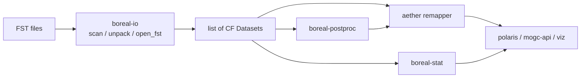

# Boreal stack contracts for a Mojo xarray / dask replacement

This tree documents how the **boreal** Python stack and **aether** use **xarray**, **dask**, and **numpy**—especially how **boreal-io** turns RPN Standard Files (FST) into CF cubes—so work in **marray-mask** can replace and accelerate the orchestration layer.

Deep engine math (morsel VM, bitmasks, benchmarks) lives in [`../ARCHITECTURE_AND_ROADMAP.md`](../ARCHITECTURE_AND_ROADMAP.md). Here we keep **cross-package contracts**: FST index/decode, lazy open layouts, missing-data conventions, attrs/dims consumers depend on, and peel→kernel→rewrap compute patterns.

## Why this exists

FST unpack and many remapping / thermo / stat kernels are **already Mojo**. The remaining tax is Python **Dataset assembly**, **dask HighLevelGraph** construction inside `open_fst`, and **peel → contiguous buffer → rewrap** around every consumer kernel. marray-mask targets that middle: parametric catalogs, L1 morselized plans, and labeled Dataset / duck-array APIs.

## Reading order

| Doc | Topic |
|-----|--------|
| [01-stack-map.md](01-stack-map.md) | Package roles; what is already Mojo vs still Python |
| [02-fst-decode-pipeline.md](02-fst-decode-pipeline.md) | Containers, index, datyp codecs → slabs |
| [03-open-fst-and-cf-assembly.md](03-open-fst-and-cf-assembly.md) | `open_fst` → `list[xr.Dataset]` |
| [04-lazy-layouts.md](04-lazy-layouts.md) | `column` / `record` / eager / `virtual` |
| [05-masking-missing-data.md](05-masking-missing-data.md) | `@@` bitmaps, NaN vs `1e30`, marray bitmasks |
| [06-cf-attrs-and-consumer-contract.md](06-cf-attrs-and-consumer-contract.md) | Dims, `fst_*` attrs, write stamps |
| [07-aether-xarray-usage.md](07-aether-xarray-usage.md) | Remap in/out; buffer handoff |
| [08-peel-kernel-rewrap.md](08-peel-kernel-rewrap.md) | postproc / stat compute patterns |
| [09-end-to-end-pipelines.md](09-end-to-end-pipelines.md) | polaris / mogc-api (path-free) |
| [10-mojo-replacement-checklist.md](10-mojo-replacement-checklist.md) | Map to roadmap M1–M6 |
| [11-non-goals.md](11-non-goals.md) | What stays Python; out of scope |

## Stack map (high level)

## Glossary

| Name | Meaning |
|------|---------|
| **boreal-io** | Product package (`import boreal.io`). Repo may still be checked out as `cmc-io`; same code. |
| **cmc-io** | Historical / checkout name; prefer **boreal-io** in docs and imports. |
| **open_fst** | Primary CF entry: paths → `list[xarray.Dataset]` (one cube per grid/vctype family). |
| **aether** | Mojo-accelerated horizontal/vertical remapping. **Does not** own FST read/write. |
| **RecordCatalog** | marray-mask M1 idea: flat index of `(var, time, level) → (file, offset, len, encoding)` matching boreal-io headers. |

## Content rules

- No absolute host paths, home directories, or operational filesystem roots in examples.
- Use placeholders such as `file.std` and `open_fst(paths, ...)`.
- Cite package modules (`boreal.io.xarray.open`) and repo-relative paths inside those projects when helpful.
